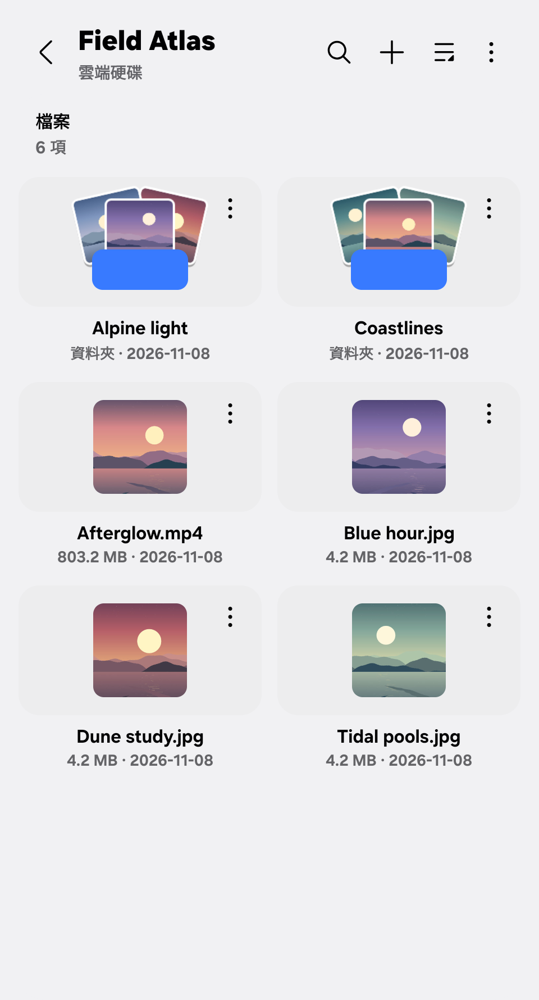
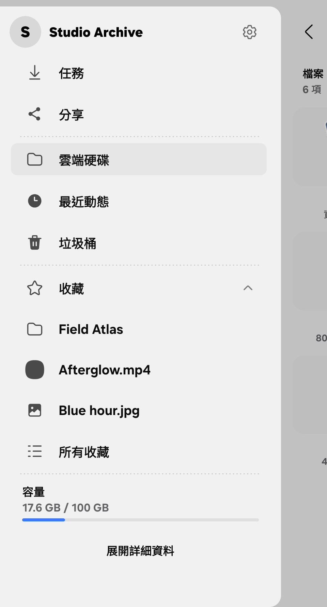
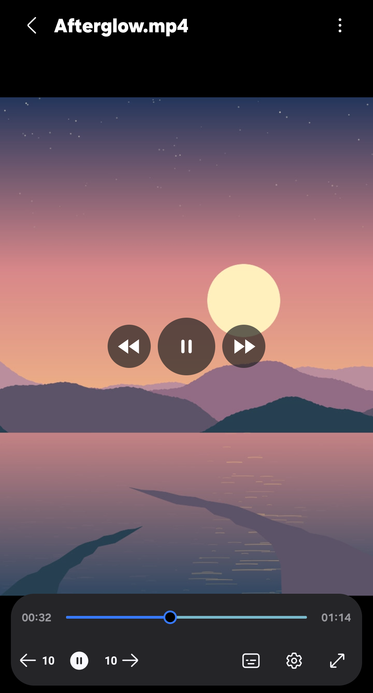

<div align="center">


# PikPak-Droid

采用原生 One UI 界面的第三方 PikPak 安卓客户端。浏览云盘、播放视频，也能从其他应用接收磁力链接。

**[下载 0.1.0 APK](https://github.com/Bengerthelorf/pikpak-droid/releases/download/v0.1.0/PikPak-Droid-0.1.0-arm64.apk)** · [版本说明](https://github.com/Bengerthelorf/pikpak-droid/releases/tag/v0.1.0) · [pikpaktui](https://github.com/Bengerthelorf/pikpaktui)

| 云盘 | 侧边栏 | 播放器 |
| :---: | :---: | :---: |
|  |  |  |

</div>

## 功能

- **浏览云盘**　切换列表与图标视图，自选文件夹封面，按类型、大小或时间分组。打开子目录后返回，会停在之前浏览的位置。
- **查找文件**　搜索整个云盘或当前文件夹。已缓存的目录会先显示，后台刷新时仍可继续浏览。可以提前缓存缩略图和封面，也可以设置缓存上限。
- **播放视频**　切换画质、音轨和字幕，字幕可从手机或云盘选取。双击左右两侧跳转，下滑收为可拖动的小窗，返回桌面可继续画中画播放。
- **管理传输**　上传文件和文件夹，把云端文件下载到手机，或从其他应用分享磁力链接到 PikPak-Droid 建立云下载任务。
- **收藏与分享**　从侧边栏直接打开收藏的文件或目录，创建带提取码的分享，也能浏览别人分享的内容并选择转存。

## 安装

需要 **Android 8.0 或更高版本**与 **ARM64** 设备。下载上方 APK，在手机上打开安装，然后用 PikPak 账号登录。支持简体中文、繁體中文和 English。Android 13 及以上可在系统「应用信息 → 语言」中切换。

## 云盘核心

PikPak-Droid 与 pikpaktui 共用 Rust 核心。打开「设置 → PikPak Core」即可检查并安装核心更新，重启应用后生效。界面和播放器更新随新版 APK 提供。[上游核心版本](https://github.com/Bengerthelorf/pikpaktui/releases)

<details>
<summary>从源码构建</summary>

准备 JDK 21、Android SDK Platform 37.1 和 Build Tools 36.0.0。首次下载 One UI 依赖时，将 GitHub Packages 用户名和具有 <code>read:packages</code> 权限的令牌分别设为 <code>ONEUI_MAVEN_USER</code> 和 <code>ONEUI_MAVEN_TOKEN</code>。

```sh
./gradlew :app:assembleDebug
```

默认 APK 输出到 <code>app/build/outputs/apk/debug/app-debug.apk</code>。仓库内附带的 ARM64 核心版本和 SHA-256 记录在 <a href="core/bundled/manifest.json">核心清单</a>中。

</details>

界面使用 [One UI Design](https://github.com/tribalfs/oneui-design) 与 SESL，播放器使用 [AndroidX Media3](https://developer.android.com/media/media3)。项目采用 [Apache License 2.0](LICENSE)。PikPak 和 One UI 商标归各自权利人所有。
